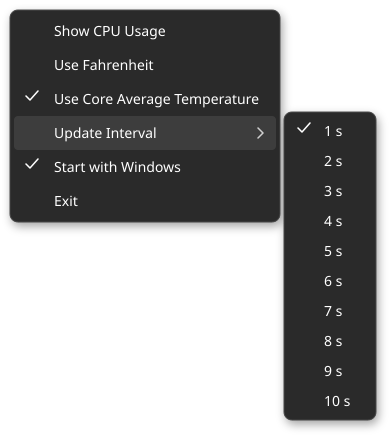

# DeepCool Digital for Windows

[](https://github.com/Shark1nat0r/deepcool-digital-windows/releases/latest)
[](https://github.com/Shark1nat0r/deepcool-digital-windows/releases)
[](https://dotnet.microsoft.com/download/dotnet/9.0)
[](LICENSE)

A small tray app that shows CPU usage, temperature, power and clock speed on the display of DeepCool DIGITAL coolers. It replaces the official DeepCool software and has no window, only a tray menu.



## Supported coolers

| Series | Models | Display shows | Fahrenheit |
|---|---|---|:---:|
| AK DIGITAL | AK400, AK500, AK500S, AK620 DIGITAL | Usage or temperature | Yes |
| AK DIGITAL NYX (G2) and PRO | AK400 G2, AK500 G2, AK620 G2, AK700 DIGITAL NYX, AK500 and AK620 DIGITAL PRO | Power, temperature, usage and clock, cycled by the cooler | Yes |
| AG DIGITAL | AG300, AG400, AG500, AG620 DIGITAL | Usage or temperature, two digits | No |

The app finds the cooler by its USB product ID. Other DeepCool devices, including the AK400 DIGITAL PRO, are not supported yet.

## Install

1. Download a build from [Releases](https://github.com/Shark1nat0r/deepcool-digital-windows/releases).
   `deepcool-display-self-contained.exe` runs as is.
   `deepcool-display-framework-dependent.exe` is smaller but needs the [.NET 9 Desktop Runtime](https://dotnet.microsoft.com/download/dotnet/9.0).
2. Install the [PawnIO driver](https://pawnio.eu/). Without it only CPU usage works, the other values show 0 and the menu shows "PawnIO driver missing".
3. Right click the exe and choose **Run as administrator**. Admin rights are needed to read the sensors and to create the autostart task.

## Tray menu

| Item | What it does |
|---|---|
| Show CPU Usage / Show CPU Temperature | Switches what the display shows. AK DIGITAL and AG only. |
| Use Fahrenheit | Shows temperatures in Fahrenheit. |
| Use Core Average Temperature | Uses the core average instead of CPU Package. See [Core Average](#core-average). |
| Update Interval | How often the display updates, from 1 to 10 seconds. |
| Start with Windows | Starts the app at logon. See [Start with Windows](#start-with-windows). |

Settings are saved between runs. Hover the tray icon to see which cooler was detected.

### Core Average

**Intel:** the average of all core temperatures.

**AMD Ryzen:** Ryzen has no per core sensors, so the app uses the CCD temperature. CPUs with two CCDs (5950X, 7950X) get the average of both. CPUs with one CCD (5800X, 7800X3D) get that single value.

The option is hidden when PawnIO is missing or the CPU reports neither value, for example Ryzen 1000 and 2000 or APUs like the 5600G and 8700G.

### Start with Windows

This creates a Task Scheduler task named "DeepCool Display" that starts the app with admin rights and no UAC prompt. Do not use the Startup folder or Task Manager startup apps instead. Windows skips apps that need admin rights there. If you move the exe, run it once from the new location and the task updates itself.

## Verify a download

Releases are built by GitHub Actions and carry a build provenance attestation:

```
gh attestation verify deepcool-display-self-contained.exe --repo Shark1nat0r/deepcool-digital-windows
```

Each release also includes `SHA256SUMS.txt`.

## Credits

Based on [deepcool-digital-linux](https://github.com/Nortank12/deepcool-digital-linux) by Nortank12.

Uses [LibreHardwareMonitor](https://github.com/LibreHardwareMonitor/LibreHardwareMonitor) (MPL 2.0), [HidSharp](https://www.zer7.com/software/hidsharp) (Apache 2.0) and [TaskScheduler](https://github.com/dahall/TaskScheduler) (MIT). Full texts are in [THIRD_PARTY_LICENSES](THIRD_PARTY_LICENSES).

## License

[MIT](LICENSE). Not affiliated with DeepCool. Use at your own risk.

Bugs go in [Issues](https://github.com/Shark1nat0r/deepcool-digital-windows/issues), ideas in [Discussions](https://github.com/Shark1nat0r/deepcool-digital-windows/discussions).
